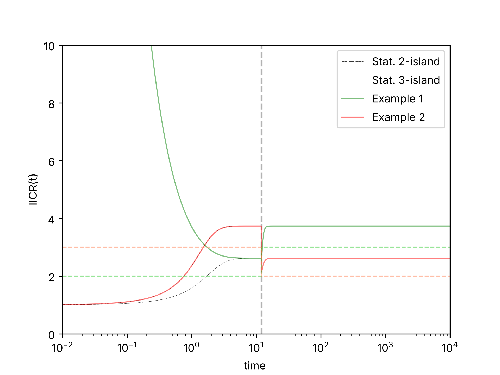
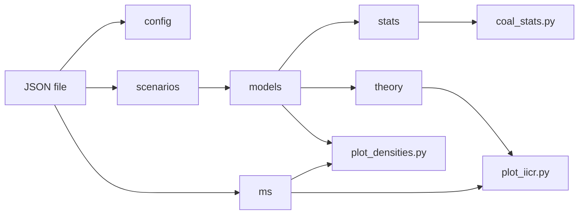

# nssc-coalescence

**Coalescence times under the non-stationary structured coalescent (NSSC).**

Structured population models whose structure changes through time (migration rates, deme sizes and number of demes) are described as Markov chains. From them, this repository computes the distribution of the coalescence time $T_2$ of a pair of lineages and the quantities derived from it:

- the **IICR** (*Inverse Instantaneous Coalescence Rate*), theoretical or estimated from [ms](https://home.uchicago.edu/rhudson1/source/mksamples.html) simulations;
- **statistics of $T_2$**: mean, variance and probability of observing at least one difference between two sequences.

This code accompanies the article **[Extending the IICR to complex nonstationary structured models](https://doi.org/10.1093/genetics/iyag040)** (Jouniaux et al., *Genetics*, 2026) and will grow with further work on coalescent statistics. See [How to cite](#how-to-cite).



*Example ([`examples/structure_change.json`](examples/structure_change.json)): 2 islands becoming 3 (green) and 3 islands becoming 2 (red). Dashed lines: IICR of the corresponding stationary models.*

## Contents

- [What this repository does](#what-this-repository-does)
- [Installation](#installation)
- [Quick start](#quick-start)
- [The parameter file](#the-parameter-file)
- [Output files](#output-files)
- [Using the code from Python](#using-the-code-from-python)
- [Code organisation](#code-organisation)
- [The model in a nutshell](#the-model-in-a-nutshell)
- [Tests](#tests)
- [How to cite](#how-to-cite)
- [Credits and license](#credits-and-license)

## What this repository does

Everything is driven by **a JSON file** describing the scenarios. Three scripts read it:

| script | what it does |
|---|---|
| `plot_iicr.py` | plots **theoretical** IICRs and **empirical** IICRs from ms simulations on the same figure |
| `plot_densities.py` | plots the densities of $T_2$, theoretical and simulated |
| `coal_stats.py` | computes the mean and variance of $T_2$, and the probability of observing at least one difference between two sequences |

Available models:

- the **non-stationary structured coalescent** (NSSC): any migration matrix and any deme sizes, with changes at arbitrary times, including changes in the number of demes;
- the **n-island model**, either stationary (exact formula) or piecewise constant.

## Installation

Requires Python ≥ 3.8.

```bash
git clone https://github.com/aljounia/nssc-coalescence.git
cd nssc-coalescence
python -m venv .venv
source .venv/bin/activate          # Windows: .venv\Scripts\activate
pip install -r requirements.txt
```

**ms is optional.** You only need it for empirical IICRs. Compile it from [Richard Hudson's page](https://home.uchicago.edu/rhudson1/source/mksamples.html), then set its folder in the `path2ms` key of the JSON file.

## Quick start

```bash
python plot_iicr.py examples/structure_change.json        # IICR figure
python plot_densities.py examples/structure_change.json   # densities of T2
python coal_stats.py examples/structure_change.json       # statistics of T2
```

Results are written **next to the JSON file**: `examples/structure_change.png`, `examples/structure_change_stats.txt`, etc.

To run your own scenarios, copy the example file and edit it.

## The parameter file

A JSON file holds **lists of scenarios** and **shared settings**. All scenario lists are optional: an empty list (`[]`) draws nothing.

```jsonc
{
  "theoretical_IICR_general": [ ... ],   // general structured models
  "theoretical_IICR_nisland": [ ... ],   // n-island models
  "scenarios": [ ... ],                  // ms simulations
  "path2ms": "./msdir/",

  "scale_params": {"N0": 1, "generation_time": 1},
  "plot_params": { ... },
  "computation_parameters": { ... },
  "custom_x_vector": {"set_custom_xvector": 0, "x_vector": 0},
  "vertical_lines": [6],
  "piecewise_constant_functions": [ ... ],
  "save_theor_IICR_as_file": 1
}
```

**Units.** Scenario times (`tau`, `vertical_lines`, …) are in units of $2N_0$ generations. On the IICR figure, time is multiplied by $2 N_0 g$ (`N0` × `generation_time`) and the IICR by $N_0$.

### Curve style

Each scenario carries its own style through the keys `color`, `linestyle`, `linewidth`, `alpha` and `label`. They are passed to matplotlib as they are, and are all optional.

### General structured model: `theoretical_IICR_general`

The scenario is split into periods. For each period you give a migration matrix and a vector of deme sizes.

| key | description |
|---|---|
| `tau` | start time of each period; the first one is `0` |
| `M` | one migration matrix per period: `M[i][j]` is the migration rate from deme `i` to deme `j` |
| `size` | one vector of relative deme sizes per period |
| `sampling` | lineages sampled in each deme, for the first period: `[2, 0, 0]` (both in deme 0) or `[1, 1, 0]` (one in deme 0, one in deme 1) |
| `glue_matrix` | *optional.* Transition matrix used when the number of demes changes. A single matrix is reused at every change; a list gives one matrix per period change. Without this key, the matrix is computed automatically (see [The model in a nutshell](#the-model-in-a-nutshell)). |
| `lineages_are_dist` | *optional.* `true` for distinguishable lineages (default: `false`) |

Example: 3 islands becoming 2 at time 6.

```json
{"M":    [[[0,1,1],[1,0,1],[1,1,0]], [[0,1],[1,0]]],
 "size": [[1,1,1], [1,1]],
 "tau":  [0, 6],
 "sampling": [2,0,0],
 "label": "3 -> 2 islands", "color": "r"}
```

Without `tau`, `M` and `size` describe a stationary model directly, with no list of periods.

### n-island model: `theoretical_IICR_nisland`

| key | description |
|---|---|
| `n` | number of islands |
| `M` | migration rate |
| `sampling_same_island` | `1` if both lineages come from the same island, `0` otherwise |
| `tau`, `size` | piecewise model only: start time and island size of each period |

If `M` is a number, the model is stationary and the IICR is computed from its **exact formula**. If `n`, `M`, `tau` and `size` are lists (one value per period), the model is piecewise constant.

### ms simulations: `scenarios`

| key | description |
|---|---|
| `ms_command` | full ms command, run from the `path2ms` folder. It must print the `time:` lines (option `-L`). |

```json
{"ms_command": "ms 2 100000 -T -L -I 2 2 0 1", "label": "ms, 2 islands", "color": "b"}
```

ms times (units of $4N_0$) are converted to units of $2N_0$. If more than 2 sequences are sampled, the empirical IICR is multiplied by $\binom{n}{2}$.

The histogram grid is set by `computation_parameters`: a `"log"` or `"linear"` grid of `number_of_values` points between `start` and `end`, grouped with a PSMC-like pattern (`pattern`, e.g. `"4*1+25*2+4+6"`). You can also give the grid directly with `custom_x_vector` (`"set_custom_xvector": 1`).

### Figure: `plot_params`

| key | description |
|---|---|
| `plot_theor_IICR` | `1` to plot the theoretical models |
| `plot_limits` | `[x_min, x_max, y_min, y_max]`; `x_max` also bounds the grid used for theoretical computations |
| `time_log` | `1` for a logarithmic time axis |
| `y_scale` | `"log"` for a logarithmic IICR axis |
| `plot_xlabel`, `plot_ylabel`, `plot_title` | figure labels |
| `save_figure`, `show_plot` | save the figure as PNG, show it on screen |

Other figure elements:
- `vertical_lines`: times (in units of $2N_0$) at which to draw a vertical line;
- `piecewise_constant_functions`: step functions (`x`, `y`, style), already at the figure's scale.

### Densities: `plot_densities`

| key | description |
|---|---|
| `densities_to_plot` | indices of the ms scenarios to plot (empty list: all of them) |
| `x_lim`, `y_lim` | axis limits, in units of $2N_0$ generations |

### Statistics: `theta`, `L`

`coal_stats.py` uses `theta` (mutation rate per site, default `1e-4`) and `L` (number of sites, default `500`). Both keys are optional and go at the top level of the JSON file.

## Output files

For a parameter file `path/name.json`:

| file | script | content |
|---|---|---|
| `path/name.png` | `plot_iicr.py` | IICR figure (if `save_figure`) |
| `path/name_IICR_gen_<i>_text_file.txt` | `plot_iicr.py` | theoretical IICR of general scenario `i`: line 1 = times, line 2 = IICR, at the figure's scale (if `save_theor_IICR_as_file`) |
| `path/name_IICR_nisland_<i>_text_file.txt` | `plot_iicr.py` | same for n-island models |
| `path/name_densities.png` | `plot_densities.py` | density figure (if `save_figure`) |
| `path/name_stats.txt` | `coal_stats.py` | one line per general scenario: `tau_last mean variance p_at_least_one_diff` |

In `name_stats.txt`, `tau_last` is the time of the scenario's last change. To read this file in Python: `np.loadtxt("name_stats.txt", skiprows=1)`.

## Using the code from Python

The scripts only assemble functions from the `nssc` package. You can use them directly in a script or a notebook:

```python
from nssc import config
from nssc.scenarios import general_model
from nssc.theory import model_iicr
from nssc.stats import coalescence_stats

p = config.load_params("examples/structure_change.json")
t = config.theory_time_grid(p)                       # grid in units of 2N0

model = general_model(p["theoretical_IICR_general"][2])
iicr = model_iicr(model, t)                          # IICR
f, F = model.pdf(t), model.cdf(t)                    # density and CDF of T2
print(coalescence_stats(model, t))                   # mean, variance, P(>= 1 difference)
```

You can also build a model without a JSON file:

```python
from nssc.models import NSSC

model = NSSC(sampling_vector=[2, 0, 0],
             times=[0, 6],
             mig_matrices=[[[0, 1, 1], [1, 0, 1], [1, 1, 0]], [[0, 1], [1, 0]]],
             deme_sizes=[[1, 1, 1], [1, 1]])
```

## Code organisation

```
├── plot_iicr.py          script: theoretical + ms IICRs
├── plot_densities.py     script: densities of T2
├── coal_stats.py         script: statistics of T2
├── nssc/                 the package
│   ├── models.py         Markov chains: NSSC, Pnisland, Q matrices and glue matrices
│   ├── scenarios.py      JSON entry → model
│   ├── config.py         JSON loading, scales, time grids
│   ├── theory.py         theoretical IICRs, distance to a PSMC curve
│   ├── ms.py             ms simulations: empirical IICRs and densities
│   ├── stats.py          mean, variance, P(at least one difference)
│   ├── plotting.py       shared plotting helpers
│   └── output.py         text output files
├── examples/             example parameter files
├── docs/                 README images
└── tests/                consistency tests
```



## The model in a nutshell

We follow two lineages backwards in time. The state of the Markov chain is the pair of demes $(i, j)$, with $i \le j$, that holds the two lineages. One extra, absorbing state stands for coalescence. The absorption time is $T_2$.

- **Migration**: each lineage in deme $i$ moves to deme $j$ at rate $M_{ij}/2$.
- **Coalescence**: two lineages in deme $i$ coalesce at rate $1/c_i$, where $c_i$ is the relative size of the deme (`size`).
- **Changes**: within each period, the rate matrix $Q_k$ is constant. The distribution of $T_2$ is obtained by chaining the exponentials $e^{Q_k \Delta t}$, computed by diagonalisation.
- **Change in the number of demes**: the demes that are kept are the first ones. If their number increases, lineages stay where they are and the new demes are empty. If it decreases, each lineage in a vanishing deme moves to a remaining deme, with probability proportional to the migration rates of the period that ends. For another rule, provide `glue_matrix`.

Computed quantities:

$$\mathrm{IICR}(t) = \frac{1 - F(t)}{f(t)}, \qquad
\mathbb{E}[T_2] = \int t\, f(t)\, dt, \qquad
\mathbb{P}(\text{at least one difference}) = 1 - \int e^{-L\theta t} f(t)\, dt$$

where $f$ and $F$ are the density and the cumulative distribution function of $T_2$. Integrals are computed numerically (Simpson's rule) on the figure's time grid: if `plot_limits[1]` is too small, they are truncated. At large times, after the last change, the ratio $(1-F)/f$ becomes numerically unstable. The IICR is then replaced by its limit, $-1/\lambda$, where $\lambda$ is the largest non-zero eigenvalue of the last matrix $Q$.

## Tests

```bash
python -m pytest tests
```

Among other things, the tests check that the rows of the glue matrices sum to 1, that the n-island model computed as a Markov chain matches the exact formula, and that NSSC and Pnisland give the same distribution for the same island model.

## How to cite

If you use this code, please cite:

> Jouniaux A., Arredondo A., Boitard S., Chikhi L., Mazet O. (2026). **Extending the IICR to complex nonstationary structured models.** *Genetics* 232(4): iyag040. https://doi.org/10.1093/genetics/iyag040

```bibtex
@article{jouniaux2026extending,
  author  = {Jouniaux, A. and Arredondo, A. and Boitard, S. and Chikhi, L. and Mazet, O.},
  title   = {Extending the {IICR} to complex nonstationary structured models},
  journal = {Genetics},
  year    = {2026},
  volume  = {232},
  number  = {4},
  pages   = {iyag040},
  doi     = {10.1093/genetics/iyag040}
}
```

GitHub also offers a ready-made citation (APA and BibTeX) through the **"Cite this repository"** button, built from [`CITATION.cff`](CITATION.cff).

The IICR and the NSSC were introduced in:

- Mazet O., Rodríguez W., Grusea S., Boitard S., Chikhi L. (2016). *On the importance of being structured: instantaneous coalescence rates and human evolution — lessons for ancestral population size inference?* Heredity.
- Rodríguez W., Mazet O., Grusea S., Arredondo A., Corujo J. M., Boitard S., Chikhi L. (2018). *The IICR and the non-stationary structured coalescent: towards demographic inference with arbitrary changes in population structure.* Heredity.

ms simulations:

- Hudson R. R. (2002). *Generating samples under a Wright–Fisher neutral model of genetic variation.* Bioinformatics.

## Credits and license

This code is adapted from two repositories by Willy Rodríguez:

- [willyrv/IICREstimator](https://github.com/willyrv/IICREstimator): IICR computation and ms simulations;
- [willyrv/nssc-tools](https://github.com/willyrv/nssc-tools): implementation of the non-stationary structured coalescent.

Both are released under the MIT license. This repository is also released under the MIT license; see [`LICENSE`](LICENSE), which keeps the original copyright notices.
